# How to Buy AI Inference on DEX.D

Sign up for [markets.dex.do](https://markets.dex.do/), fund your **Funding Account** with SHELL, buy access to a model, and configure a Codex CLI profile. This guide uses the `gpt-6.1-sol` model.



## Sign up for DEX.DO

Go to [markets.dex.do](https://markets.dex.do/), click **Sign in**, and choose a sign-up method.

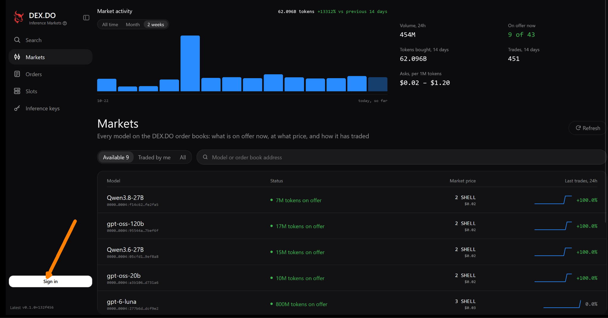

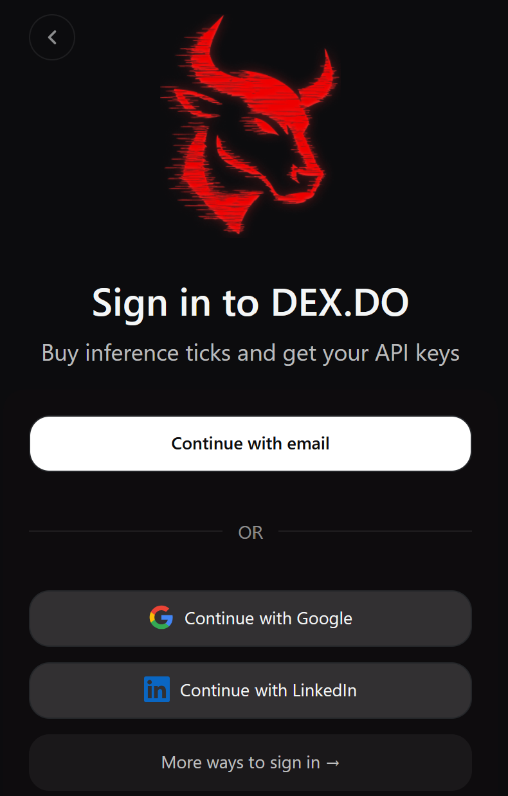



## Add funds to your Funding Account

After you sign up, the **Funding accounts** page opens. You use funds from your Funding Account to pay for model ticks. To create the account, make an initial transfer of at least **10 SHELL**.


You can top up your Funding Account with SHELL either **by paying with a card** or by transferring funds **from your** [**Acki Nacki Wallet**](https://ackinacki.com/wallet).


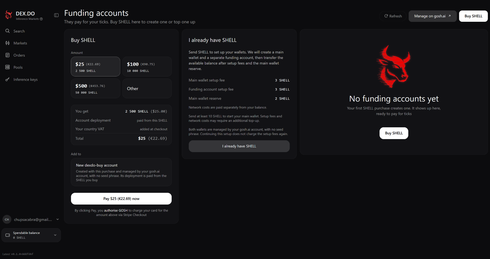

### Buy SHELL with a card



Choose the amount of SHELL to buy in the **Buy SHELL** section.

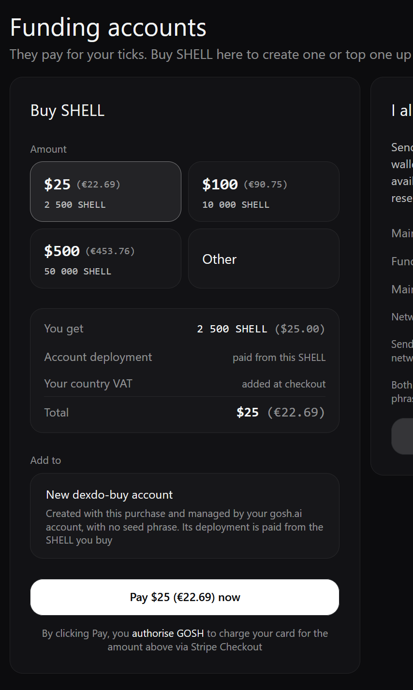



Enter your card details and complete the payment.

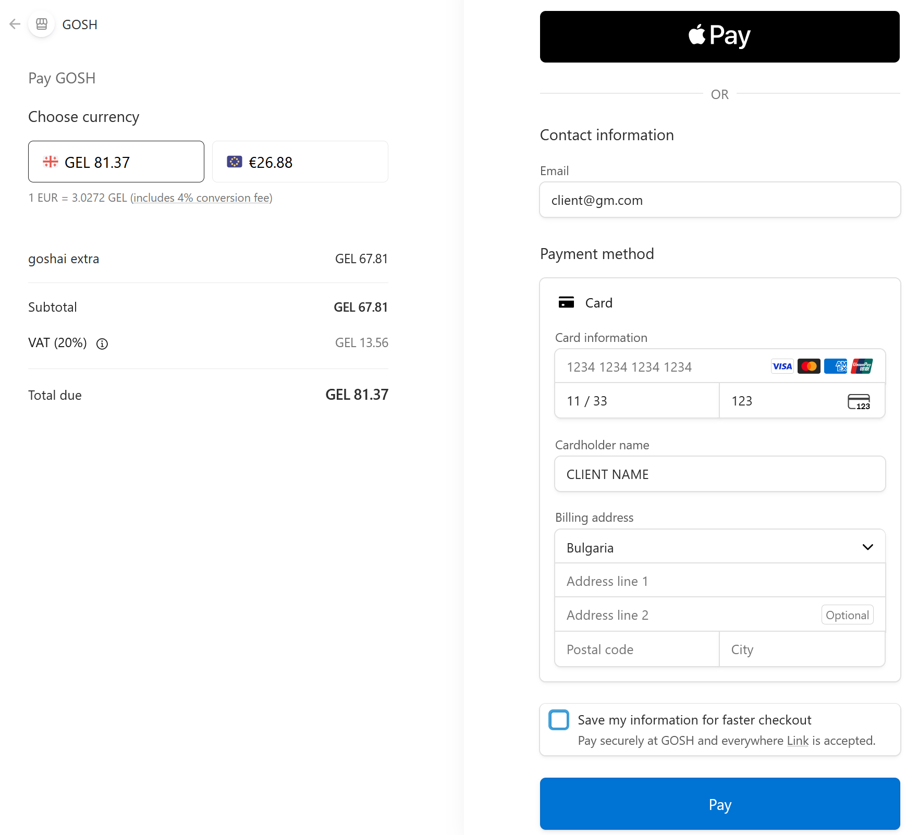



### Transfer SHELL from Acki Nacki Wallet



Open the **I already have SHELL** section.

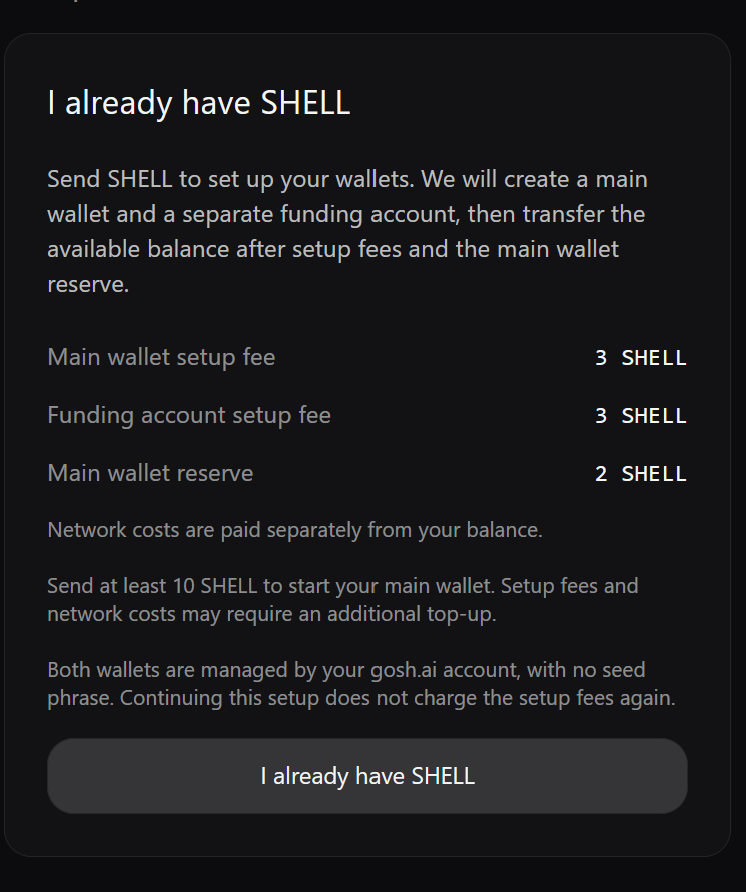



Use the [**Acki Nacki Wallet app**](https://ackinacki.com/wallet) to scan the QR code shown in your account. You can also **copy the address below the QR code** and paste it into the recipient address field in your wallet.




Transfer at least **10 SHELL**.

\
At this stage, the **Funding Account** has not yet been deployed, so its address will have the status **`NonExist`**. **This is expected behavior.** Once the SHELL transfer is received, the system will automatically deploy the Funding Account and all required contracts.


**If DEV mode** is enabled in your Acki Nacki Wallet, **DO NOT** **check the box** to Auto-convert to VMSHELL


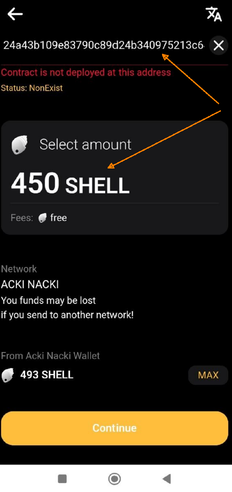




The initial transfer goes to your **Main Wallet.** DEX.DO automatically sets up your Main Wallet, creates your **Funding Account**, and credits the remaining SHELL to it after deducting setup fees, the Main Wallet reserve, and network fees.


<table><thead><tr><th width="313.35003662109375">Amount</th><th>Purpose</th></tr></thead><tbody><tr><td>3 SHELL</td><td>Main Wallet deployment</td></tr><tr><td>2 SHELL</td><td>Main Wallet reserve for future network fees</td></tr><tr><td>3 SHELL</td><td>Funding Account setup</td></tr></tbody></table>


You can see your balances in **Spendable balance** in the lower-left corner. \
Click **All funding accounts** to add funds, or click **Manage on gosh.ai** to manage your account on [gosh.ai](https://gosh.ai/).


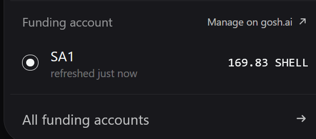



## Buy access to the model

In the left sidebar, open **Markets** and select a model. For this example, select `gpt-6.1-sol`.

Start a purchase request and fill in the fields.

<table><thead><tr><th width="235">Field</th><th>Example value</th></tr></thead><tbody><tr><td><strong>Amount</strong></td><td>125 million model tokens (125 ticks).  One tick equals 1 million tokens.</td></tr><tr><td><strong>Price per tick</strong></td><td>16 SHELL per tick.</td></tr></tbody></table>

Check the **Estimated transfer amount** and make sure your Funding Account has enough funds. In this example, the order budget is **2,000 SHELL** (125 × 16). The estimated transfer is **2,332 SHELL**, including the fee, buyer bond, and gas reserve.

Click **Create request**. DEX.DO creates a Trading Wallet when you make your first purchase.

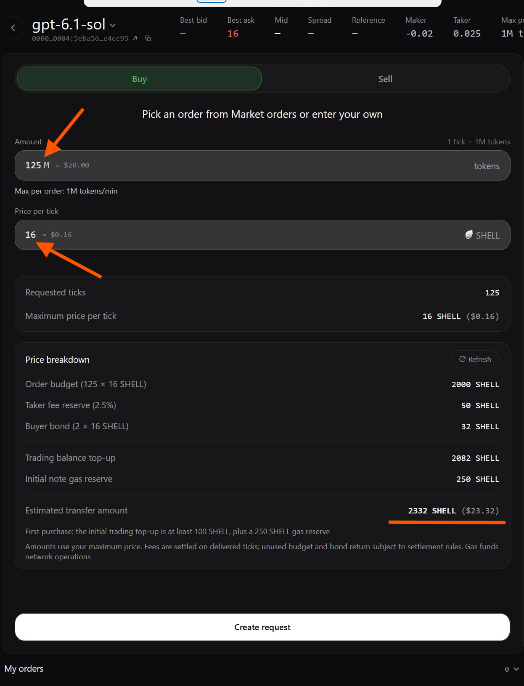

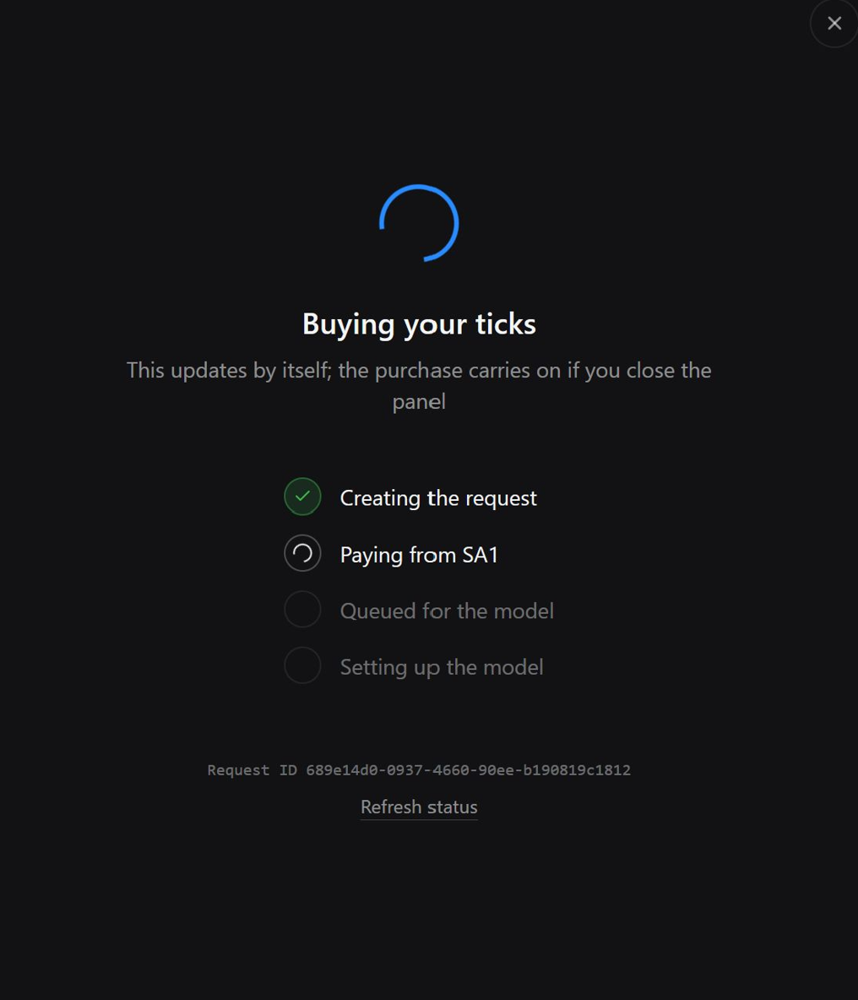

Wait for the status to change to **Serving** with a green indicator. If the request stays **Pending**, [contact support via chat](https://t.me/c/3819653418/3477).

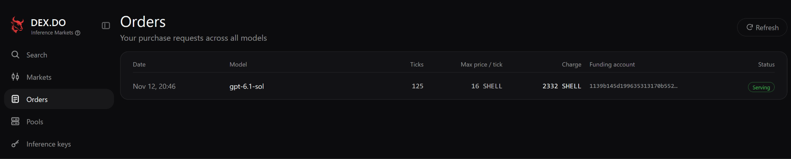


DEX.DO uses funds from your Funding Account to top up the **Trading balance** and **Fuel balance**. DEX.DO deducts the funds for model access immediately. You can check your balances in **Spendable balance**.


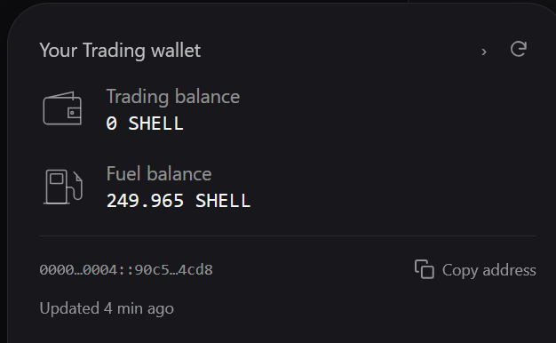



## Configure Codex CLI

To start using your purchased model, configure a **Codex CLI profile** to connect through DEX.DO.

For step-by-step instructions, see [How to Set Up Codex CLI](how-to-set-up-codex-cli.md)


