# How to Buy AI Inference on DEX.DO

Sign up for [markets.dex.do](https://markets.dex.do/), fund your **Funding Account** with [SHELL](../../glossary.md#shell), buy access to a model, and configure a Codex CLI profile. This guide uses the `gpt-6.1-sol` model.





## Sign up for DEX.DO

Go to [markets.dex.do](https://markets.dex.do/), click **Sign in**, and choose a sign-up method.

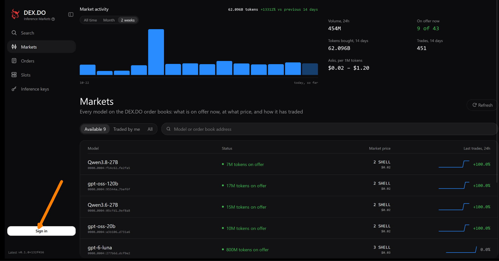

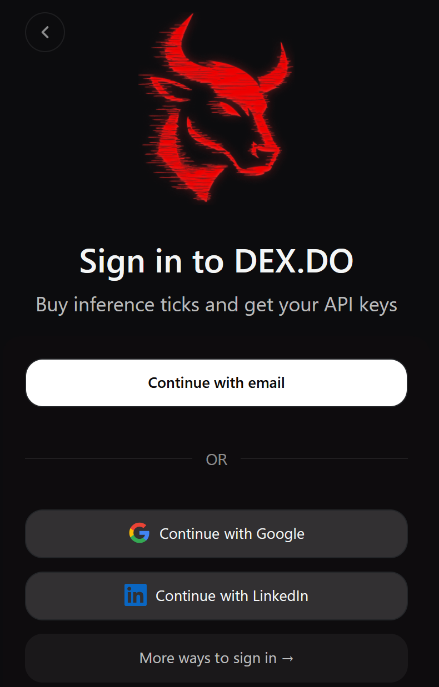



## Choose a model and an offer

In the left sidebar, open **Markets**. It lists every model with tokens on offer, its market price per tick, and its volume.

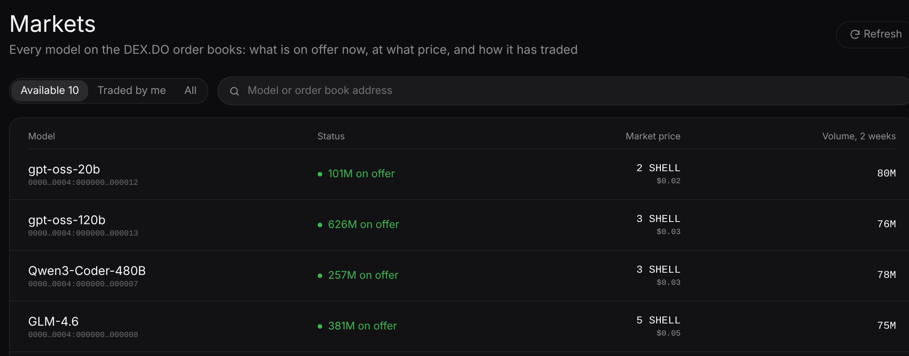



### Review the order price and top-up amount

After you enter the number of tokens and the maximum price per tick, review the **Order price breakdown**. \
In this example, you’re buying **10 million tokens (10 ticks)** at a maximum price of **2 SHELL per tick**.

<table data-header-hidden><thead><tr><th width="166.75006103515625"></th><th width="136.29998779296875" align="center"></th><th></th></tr></thead><tbody><tr><td>Item</td><td align="center">Amount (SHELL)</td><td>What it covers</td></tr><tr><td><strong>Order budget</strong></td><td align="center">20 </td><td>The budget for inference, calculated as 10 ticks × 2 SHELL.</td></tr><tr><td><strong>Taker fee reserve</strong></td><td align="center">0.5 </td><td>2.5% of the order budget, set aside to cover the marketplace fee when you buy from an existing sell order.</td></tr><tr><td><strong>Buyer bond</strong></td><td align="center">4 </td><td>A deposit equal to the price of two ticks, held for the duration of the deal.</td></tr><tr><td><strong>Order total</strong></td><td align="center"><strong>24.5</strong> </td><td>The order budget, fee reserve, and buyer bond combined.</td></tr></tbody></table>

When the deal settles, any unused portion of the fee reserve returns to your **Trading Wallet**. If the deal settles normally, the full buyer bond also returns to your wallet. If a dispute arises or the deal terms are breached, part of the bond may be withheld.

#### Review the top-up amount for your first purchase

To make your first purchase on DEX.DO, you’ll need to create a **Funding Account** and deploy a **Trading Wallet**. \
The **Buy** panel shows the **Required credits to deploy wallet and buy tokens** section.


**Funding Account -** a SHELL account linked to your [**gosh.ai** ](https://gosh.ai/)account that you use to pay for model access on **markets.dex.do**. It covers the cost of inference, any required **Trading Wallet** top-up, and the wallet setup fee if needed.

**Trading Wallet -** a wallet funded from your **Funding Account** that pays for inference across all your models on DEX.DO. DEX.DO creates it automatically on your first purchase. It holds separate balances for inference payments (**Trading Balance**) and blockchain transaction fees (**Fuel Balance**).


Expand **Spendable top-up** and **Fuel reserve** to see how the funds are allocated.

* **Spendable top-up — 142 SHELL.** Of this amount, **24.5 SHELL** covers the current order and **117.5 SHELL** remains available for future purchases. The minimum top-up for your **Trading Wallet**’s spendable balance is **100 SHELL**.
* **Fuel reserve — 258 SHELL.** Of this amount, **250 SHELL** is reserved for **Trading Wallet** network operations and **8 SHELL** goes toward setting up your **Funding Account**.
* **Total credits required amount — 400 SHELL ($4.00).** This is the total amount you need to add. The dollar amount is rounded up to a whole dollar, with a minimum top-up of **$4.00**.

Click **Add credits to deploy wallet and buy** to continue.




## Add credits

The **Add credits** dialog opens with the required top-up amount prefilled. Choose how to fund your first purchase.

* **Buy by Card** — buy SHELL by card through Stripe.
* **Crypto payment** — buy SHELL with a supported cryptocurrency through NOWPayments.
* **Deposit from Wallet** — transfer SHELL you already hold in your [Acki Nacki Wallet](https://ackinacki.com/wallet).

### Buy by card



Check the amount: **400 SHELL ($4)**, what you get, and the total. VAT is added at checkout. Click **Pay** under the total.




Enter your card details on Stripe Checkout and complete the payment.

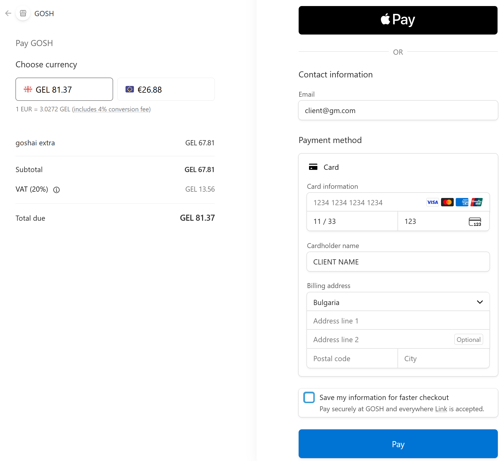



Follow the progress in the dashboard. After payment on Stripe, DEX.DO delivers the SHELL to your gosh.ai account, creates your Funding Account if needed, and transfers the available SHELL to it. This can take a few minutes.


The default name for your **Funding Account** is `dexdo-buy`





When **SHELL added** appears, your Funding Account **dexdo-buy** holds the SHELL: 400 SHELL minus the 8 SHELL setup. \
Click **Back to buying ticks**.

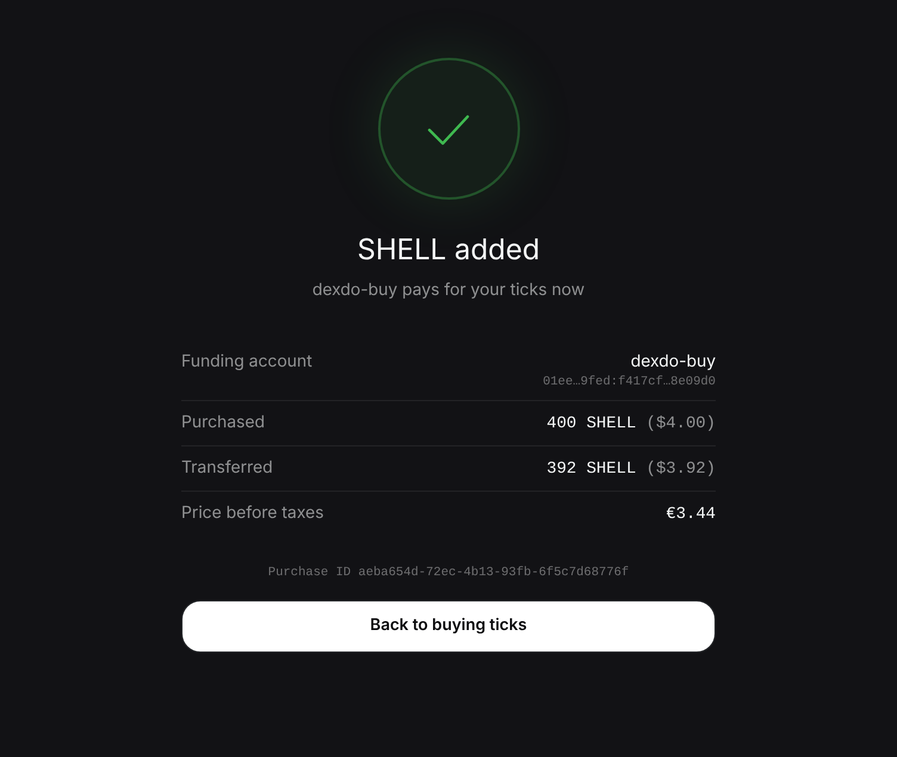



### Crypto payment



Select **Crypto payment** and check the prefilled top-up amount. Under **Country of residence**, select your country so the dashboard can show the total including VAT.



Under **Cryptocurrency**, choose an available currency. If the list shows several networks for the same currency, select the one you will use for the transfer. If your order is below the minimum for that currency, choose another currency or increase the top-up amount. You can also switch to **Buy by Card**.



Review **Total including VAT** in euros. **You pay** shows an estimate in the selected cryptocurrency when one is available.

<figure>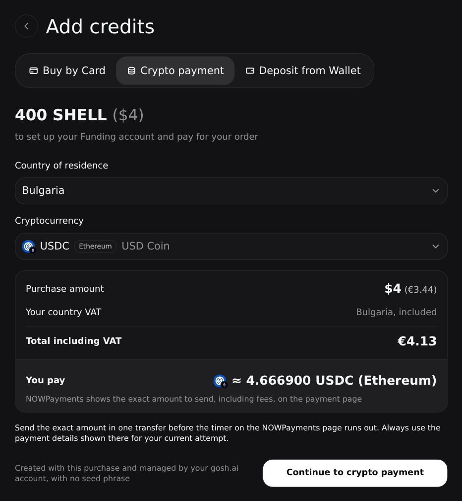<figcaption>
Example estimate for 400 SHELL with Bulgaria selected and payment in USDC on Ethereum. Your form shows the currencies available for your order.
</figcaption></figure>

Select **Continue to crypto payment**. On the NOWPayments page, check the exact amount including fees, the network, the payment details, and the time remaining. Send the exact amount in one transfer before the timer expires. Use the details shown for this payment attempt.



Return to the dashboard to follow the payment and SHELL delivery. The status updates automatically. When **SHELL added** appears, check the amount credited to your Funding Account and select **Back to buying ticks** to resume your order.



### Deposit from your Acki Nacki Wallet



Choose **Deposit from Wallet**. The page asks you to **Send 400 SHELL** and shows a QR code and an address.

* Scan the QR code with the [**Acki Nacki Wallet app**](https://ackinacki.com/wallet): the amount is already filled in.
* Or click **Copy** next to the address and paste it into the recipient field in your wallet.
* On a phone, tap **Pay with AN Wallet** — or the QR code itself — to open the wallet with the amount filled in.

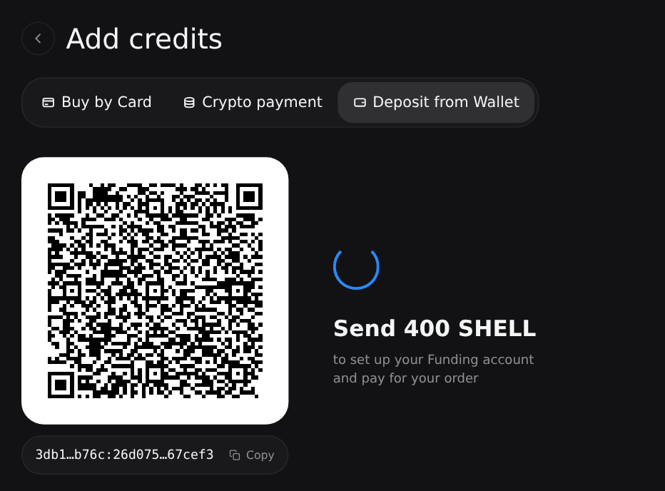

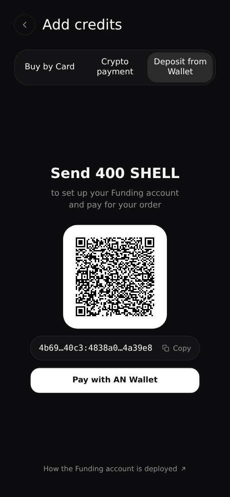



Send the whole amount from your wallet.

At this stage, the **Funding Account** has not yet been deployed, so its address will have the status **`NonExist`**. \
**This is expected behavior.** Once the SHELL transfer is received, the system will automatically deploy the Funding Account and all required contracts.


**If DEV mode** is enabled in your Acki Nacki Wallet, \
**DO NOT** **check the box** to `Auto-convert to VMSHELL`


<figure><figcaption></figcaption></figure>



Once the whole amount has arrived, DEX.DO sets up your main wallet, creates your Funding Account **dexdo-buy**, and transfers the available balance to it.

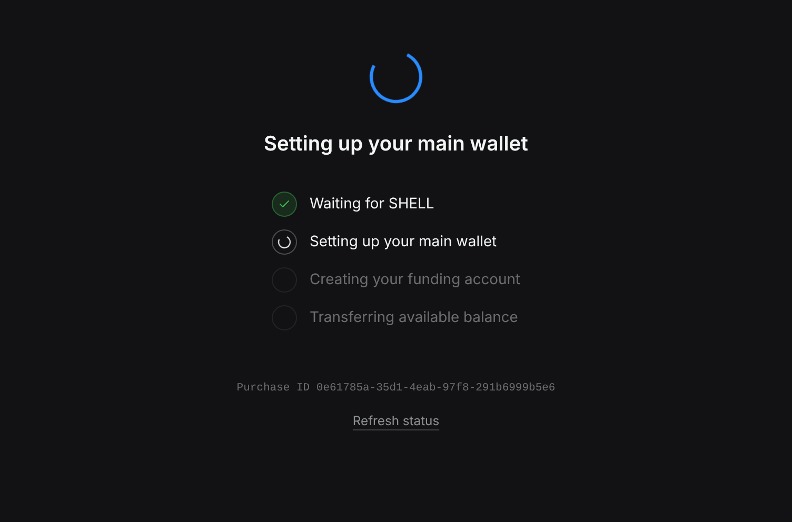



When **Ready** appears, click **Back to buying ticks**.

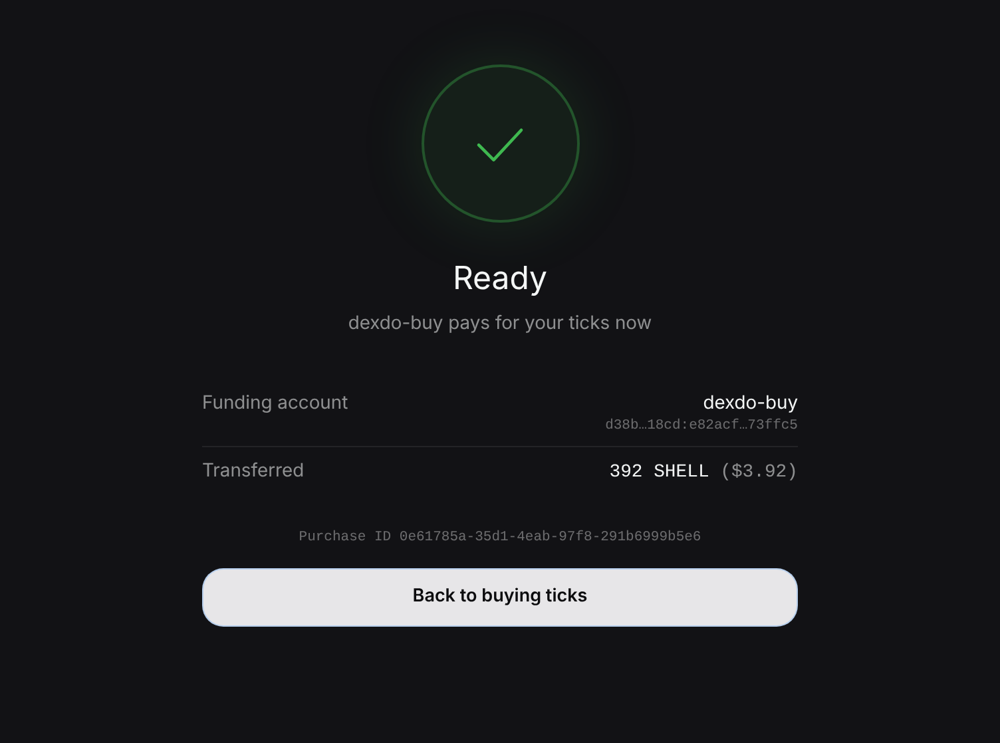



Your Funding Account balance is shown in **Spendable balance** in the lower-left corner. Open it to see your Trading Wallet and Funding Accounts.


To add funds later, select **All funding accounts**.\
To manage your account on gosh.ai, click **Manage on** [gosh.ai](https://gosh.ai/).





## Buy access to the model

**Back to buying ticks** returns you to the same model with the same order.

Under **Order total**, the line **+ Wallet deploy** shows what deploying your Trading Wallet adds to this first order: 325.5 SHELL — the rest of the 100 SHELL minimum (75.5 SHELL, which stays on your Trading Wallet for future orders) and 250 SHELL of fuel. DEX.DO pays for both from your Funding Account.

Click **Create request**. DEX.DO creates a Trading Wallet when you make your first purchase.

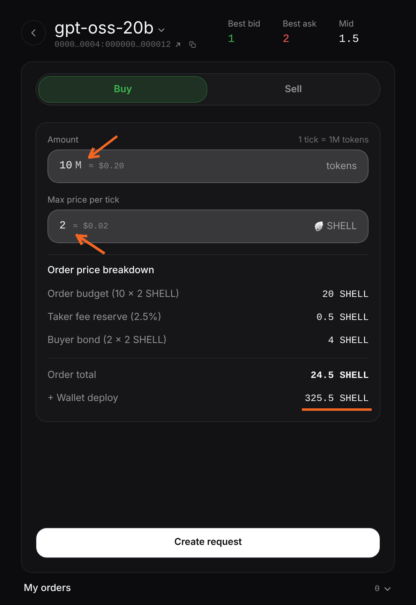

The panel shows the purchase step by step: **Creating the request**, **Paying from dexdo-buy**, **Queued for the model**, and **Setting up the model**. You can close the panel — the purchase carries on, and you can follow it in **Orders**.

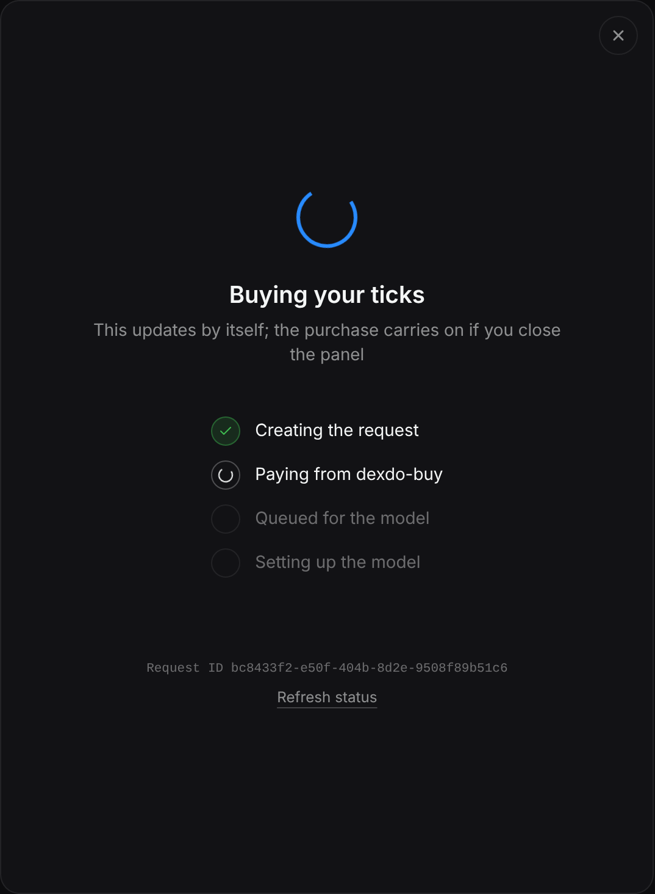

When **Ticks bought** appears, select **Continue to API keys**, or wait for the 10-second countdown. The dashboard opens **Inference keys**. Select an active key that can access the model you bought. If you see **Some slots are ready**, open **Pools** to check which slots are **Ready**.

In **Orders**, a green **Serving** status indicates that the order is ready. If the request stays **Pending**, [contact support via chat](https://t.me/c/3819653418/3477).

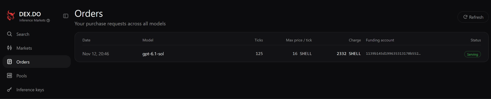


DEX.DO uses funds from your Funding Account to top up the **Trading balance** and **Fuel balance**. DEX.DO deducts the funds for model access immediately. You can check your balances in **Spendable balance**.


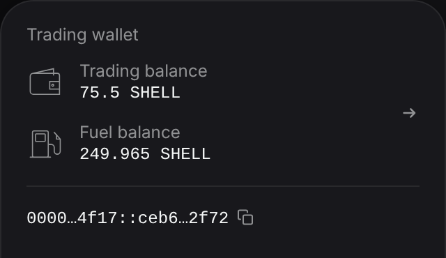



## Get an API key

On [markets.dex.do](https://markets.dex.do/), open **Inference keys**. On a new account, your first purchase creates a shared key labeled **All current and future models**. You can keep using that key as more purchased models become ready. Select the key and click **Copy** next to **API key**.

<figure>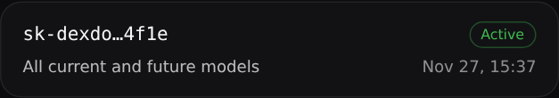<figcaption>
Inference keys after the first purchase on a new account
</figcaption></figure>

<figure><figcaption>
Desktop
</figcaption></figure>

For a key limited to specific models, select **Create API key** → **Selected models**, choose the ready models you want to include, and select **Create API key**. You can also reuse an existing active key that includes your model.

Later purchases keep your existing keys and their permissions. If you deleted your shared key and need another one, select **Create API key** → **Any**. To change which models an existing key can access, open it and select **Edit models**.

Use this key to configure Codex CLI and Codex Desktop.



## Configure Codex CLI or Desktop

To start using your purchased model, configure **Codex CLI or Codex Desktop** to connect to DEX.DO.

For step-by-step instructions, see [How to Set Up Codex CLI](how-to-set-up-codex-cli.md) or [How to Set Up Codex Desktop](how-to-set-up-codex-desktop.md)



## **View Token Usage**

Open **Inference keys** in the dashboard and select the active API key you want to check. Below the list of models in the API key details, you will find the **Usage** section. It displays your account's usage statistics for the models accessible through the selected API key.

**Total tokens** includes all four token counts shown in **Usage**.

* **Uncached input tokens** — input tokens processed without using the cache.
* **Output tokens** — tokens generated by the model.
* **Cache read tokens** — input tokens read from the cache.
* **Cache write tokens** — input tokens written to the cache.

Open **All activity** to compare **Today** and **All time**, **By model** for a breakdown by model over the last 30 days, or **Daily usage** for a day-by-day breakdown over the last 7 days.



## How do I check the connection to a Seller?

After you purchase access to a model, the dashboard automatically tests each new seller connection once the slot is ready. \
You can view the result or run another test from the **Pools** page.

1. Open **Pools**, expand the model, and find the slot you want to check. **Max concurrency** shows how many inference requests this slot can handle at the same time. Under **Seller status**, select **Connection details**.

<figure><figcaption>
Open Connection details on the Pools page
</figcaption></figure>

2. In **Seller connection**, you can also see the slot’s **Max concurrency**. **Last checked** shows when the last test finished. To run a new test, select **Test connection**.

<figure><figcaption></figcaption></figure>

3. The slot must be **Ready** and have an active deal. Once the test starts, it can take up to five minutes.

<figure><figcaption></figcaption></figure>

<table data-header-hidden data-search="false"><thead><tr><th width="163.8499755859375"></th><th></th></tr></thead><tbody><tr><td>Seller status</td><td>What it means</td></tr><tr><td><strong>Not tested</strong></td><td>The connection has not been tested yet.</td></tr><tr><td><strong>Queued</strong></td><td>The test is waiting to start.</td></tr><tr><td><strong>Checking…</strong></td><td>The test is in progress.</td></tr><tr><td><strong>OK</strong></td><td>The model returned the expected <code>OK</code> response during the last test.</td></tr><tr><td><strong>Check failed</strong></td><td>The test encountered an error or received an unexpected response. Open <strong>Connection details</strong> to see what happened.</td></tr><tr><td><strong>Result unknown</strong></td><td>The test ended without a confirmed result. You can try again when the slot is ready.</td></tr></tbody></table>


**Test connection** sends a request to the model, consuming a small number of tokens purchased for the slot.\
**Refresh** reloads the displayed status without sending a request to the model or consuming tokens.


## How can a buyer close an order?

If the seller stops responding, you can close your order by following these steps:

1. Go to **Orders** in the left-hand menu.
2. Open the order you want to close.
3. Click **Stop order** at the bottom of the panel.
4. Review the closing conditions and click **Stop order** again to confirm.

The order status will change to **Closing**. Click **Refresh** to check the status.

Once all associated deals are confirmed closed, the order status will change to **Filled**, and the message **The deal is closed** will appear in the order details.

Any remaining funds will be returned to your **Trading Wallet** after final settlement and applicable deductions. They will **not** be automatically returned to your Funding Account.


The **Stop order** button is available only when the order has deals eligible to be stopped. If the button is not visible, refresh the order status. If you are still unable to close the order, contact support.

