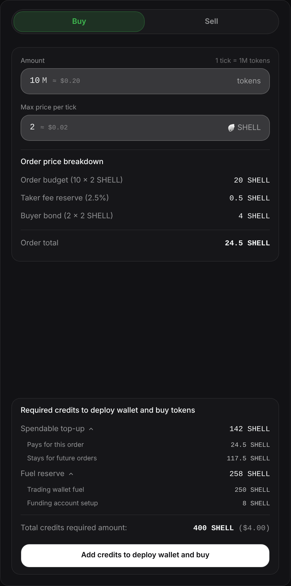
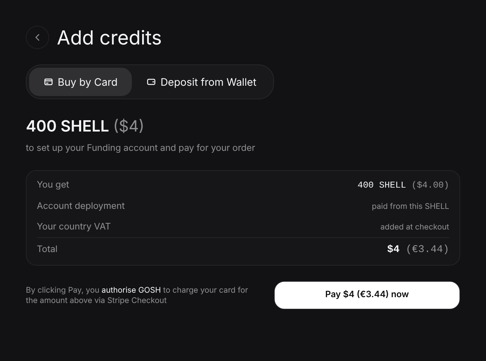
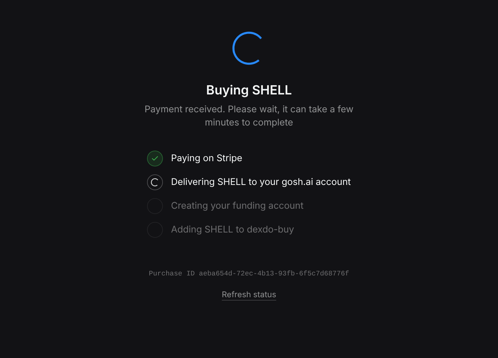
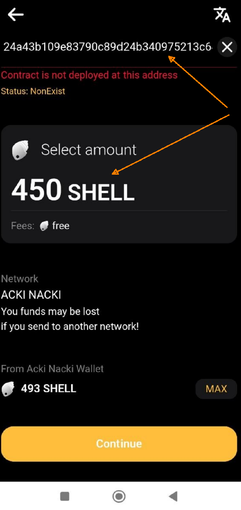
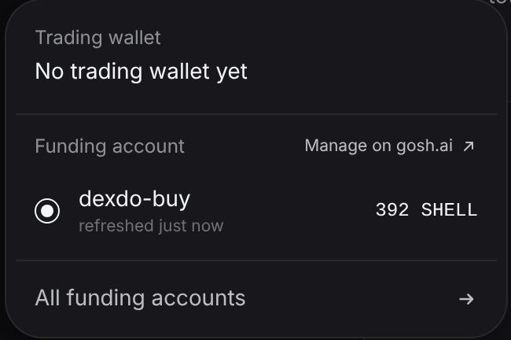
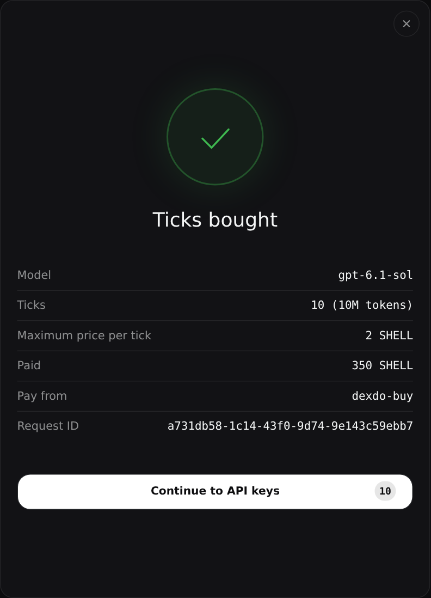

# How to Buy AI Inference on DEX.DO

Sign up for [markets.dex.do](https://markets.dex.do/), fund your **Funding Account** with SHELL, buy access to a model, and configure a Codex CLI profile. This guide uses the `gpt-6.1-sol` model.





## Sign up for DEX.DO

Go to [markets.dex.do](https://markets.dex.do/), click **Sign in**, and choose a sign-up method.




## Choose a model and an offer

In the left sidebar, open **Markets**. It lists every model with tokens on offer, its market price per tick, and its volume.




## Check the price

The buy panel shows what the order costs and how many credits it needs.

**Order price breakdown** is the order itself:

* **Order budget** — ticks × max price per tick: 10 × 2 = 20 SHELL.
* **Taker fee reserve** — 2.5% of the budget: 0.5 SHELL.
* **Buyer bond** — the price of 2 ticks: 4 SHELL.
* **Order total** — 24.5 SHELL.

Your first purchase also deploys your **Trading Wallet** and creates your **Funding Account**, so the card below it reads **Required credits to deploy wallet and buy tokens**. Click a line to see its parts:

* **Spendable top-up** — the Trading Wallet needs at least 100 SHELL. It pays for this order (24.5 SHELL); the rest stays for future orders.
* **Fuel reserve** — 250 SHELL of Trading Wallet fuel for network operations, plus 8 SHELL to set up the Funding Account.
* **Total credits required amount** — rounded up to whole dollars, $4 at least: **400 SHELL ($4.00)** here. What the rounding adds stays spendable in your Funding Account.


On a short screen, **Order price breakdown** folds into one line with the order total. Tap it to see the lines.


Click **Add credits to deploy wallet and buy**.



## Add credits

**Add credits** opens with the amount your order needs. Choose **Buy by Card** or **Deposit from Wallet**.

### Buy by card



Check the amount: **400 SHELL ($4)**, what you get, and the total. VAT is added at checkout. Click **Pay** under the total.




Enter your card details on Stripe Checkout and complete the payment.




Wait while DEX.DO buys your SHELL. The page shows each step: **Paying on Stripe**, **Delivering SHELL to your gosh.ai account**, **Creating your funding account**, and **Adding SHELL to dexdo-buy**. This can take a few minutes.




When **SHELL added** appears, your Funding Account **dexdo-buy** holds the SHELL: 400 SHELL minus the 8 SHELL setup. Click **Back to buying ticks**.




### Deposit from your Acki Nacki Wallet



Choose **Deposit from Wallet**. The page asks you to **Send 400 SHELL** and shows a QR code and an address.

* Scan the QR code with the [**Acki Nacki Wallet app**](https://ackinacki.com/wallet): the amount is already filled in.
* Or click **Copy** next to the address and paste it into the recipient field in your wallet.
* On a phone, tap **Pay with AN Wallet** — or the QR code itself — to open the wallet with the amount filled in.




Send the whole amount from your wallet.

At this stage, the **Funding Account** has not yet been deployed, so its address will have the status **`NonExist`**. **This is expected behavior.** Once the SHELL transfer is received, the system will automatically deploy the Funding Account and all required contracts.


**If DEV mode** is enabled in your Acki Nacki Wallet, **DO NOT** **check the box** to Auto-convert to VMSHELL





Once the whole amount has arrived, DEX.DO sets up your main wallet, creates your Funding Account **dexdo-buy**, and transfers the available balance to it.




When **Ready** appears, click **Back to buying ticks**.




Either way, DEX.DO deducts **8 SHELL** to set up your accounts. The rest goes to **dexdo-buy**.


Your Funding Account balance is shown in **Spendable balance** in the lower-left corner. Open it to see your Trading Wallet and Funding Accounts, click **All funding accounts** to add funds, or click **Manage on gosh.ai** to manage your account on [gosh.ai](https://gosh.ai/).





## Buy access to the model

**Back to buying ticks** returns you to the same model with the same order.

Under **Order total**, the line **+ Wallet deploy** shows what deploying your Trading Wallet adds to this first order: 325.5 SHELL — the rest of the 100 SHELL minimum (75.5 SHELL, which stays on your Trading Wallet for future orders) and 250 SHELL of fuel. DEX.DO pays for both from your Funding Account.

Click **Create request**. DEX.DO creates a Trading Wallet when you make your first purchase.

The panel shows the purchase step by step: **Creating the request**, **Paying from dexdo-buy**, **Queued for the model**, and **Setting up the model**. You can close the panel — the purchase carries on, and you can follow it in **Orders**.

When **Ticks bought** appears, the model is ready. Click **Continue to API key**, or wait a few seconds for it to open by itself.

Wait for the status to change to **Serving** with a green indicator. If the request stays **Pending**, [contact support via chat](https://t.me/c/3819653418/3477).


DEX.DO uses funds from your Funding Account to top up the **Trading balance** and **Fuel balance**. DEX.DO deducts the funds for model access immediately. You can check your balances in **Spendable balance**.





## Get an API key

On [markets.dex.do](https://markets.dex.do/), open **Inference keys**, select **All current and future models**, or choose a key for a specific model, and click **Copy** next to the key in the panel that opens.&#x20;

<figure><figcaption>
List of keys in the Inference keys section
</figcaption></figure>

<figure><figcaption>
Desktop
</figcaption></figure>

Use this key to configure Codex CLI and Codex Desktop.



## Configure Codex CLI or Desktop&#x20;

To start using your purchased model, configure **Codex CLI or Codex Desktop** to connect to DEX.DO.

For step-by-step instructions, see [How to Set Up Codex CLI](how-to-set-up-codex-cli.md) or [How to Set Up Codex Desktop](how-to-set-up-codex-desktop.md)



## How can a buyer close an order?

If the seller stops responding, you can close your order by following these steps:

1. Go to **Orders** in the left-hand menu.
2. Open the order you want to close.
3. Click **Stop order** at the bottom of the panel.
4. Review the closing conditions and click **Stop order** again to confirm.

The order status will change to **Closing**. Click **Refresh** to check the status.

Once all associated deals are confirmed closed, the order status will change to **Filled**, and the message **The deal is closed** will appear in the order details.

Any remaining funds will be returned to your **Trading Wallet** after final settlement and applicable deductions. They will **not** be automatically returned to your Funding Account.


The **Stop order** button is available only when the order has deals eligible to be stopped. If the button is not visible, refresh the order status. If you are still unable to close the order, contact support.

