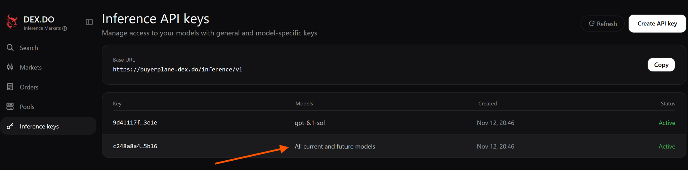
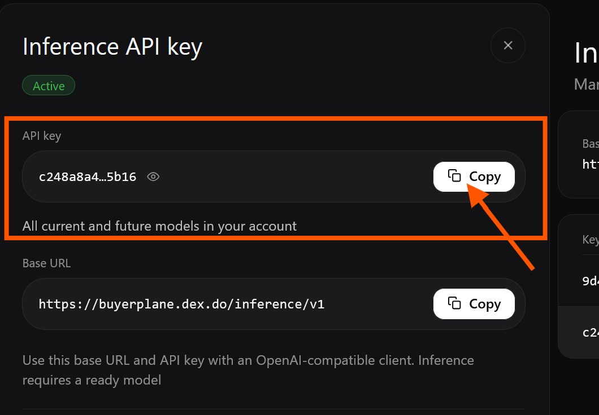
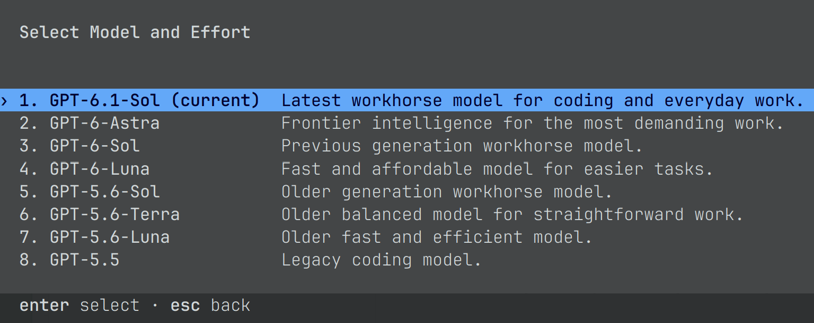
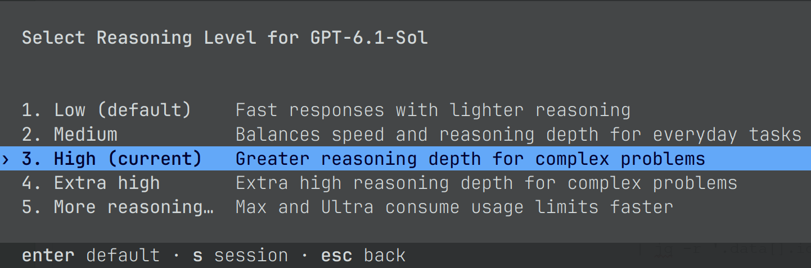

# How to Set Up Codex CLI

**Before you begin, make sure you have registered on** [**markets.dex.do**](https://markets.dex.do/)**, funded your Funding Account with SHELL, and purchased access to a model.**

If you haven't completed these steps yet, follow the [How to Buy AI Inference on DEX.DO](how-to-buy-ai-inference-on-dex.do.md) guide.


In this guide, we'll use the `gpt-6.1-sol` model as an example.




### Add DEX.DO as a provider

The profile sets the model and reasoning effort for sessions that use DEX.DO as the provider. Open `~/.codex/config.toml` and add the following section. If a `[model_providers.dexdo]` section already exists, update it.

```toml
[model_providers.dexdo]
name = "Dexdo Proxy"
base_url = "https://buyerplane.dex.do/inference/v1"
env_key = "DEXDO_API_KEY"
wire_api = "responses"
```



### Create a profile

In `~/.codex/`, create a file named `dexdo-6-1-sol.config.toml` with the following settings.

```toml
model = "gpt-6.1-sol"
model_provider = "dexdo"
model_reasoning_effort = "high"
```



### Get an API key

On [markets.dex.do](https://markets.dex.do/), open **Inference keys**, select **All current and future models**, and click **Copy** next to the key in the panel that opens.







### Set the environment variable

On macOS or Linux (Bash or Zsh), run the following command. Replace `your-api-key` with the API key you copied.

```bash
export DEXDO_API_KEY="your-api-key"
```

Run Codex CLI from the same terminal. If you open a new terminal, set `DEXDO_API_KEY` again.



## Verify the connection

Start Codex with the DEX.DO profile.

```bash
codex -p dexdo-6-1-sol
```

Send a short prompt and verify that the model responds.

To select a different model at startup, pass its identifier with the `-m` flag.

```bash
codex -p dexdo-6-1-sol -m another-model
```

To change the reasoning effort during a Codex session, enter `/model`, select a model, and choose the reasoning effort.







## Reference

### List available models

```bash
curl -s https://buyerplane.dex.do/inference/v1/models \
  -H "Authorization: Bearer $DEXDO_API_KEY" \
  | jq -r '.data[].id'
```

### DEX.DO API URLs

<table><thead><tr><th width="243.25">Environment</th><th>Base URL</th></tr></thead><tbody><tr><td>Main</td><td><code>https://buyerplane.dex.do/inference/v1</code></td></tr><tr><td>Dev</td><td><code>https://buyerplane-dev.dex.do/inference/v1</code></td></tr></tbody></table>
